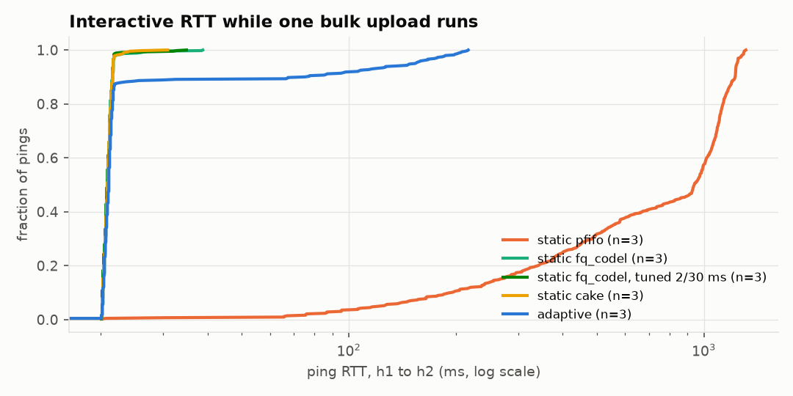
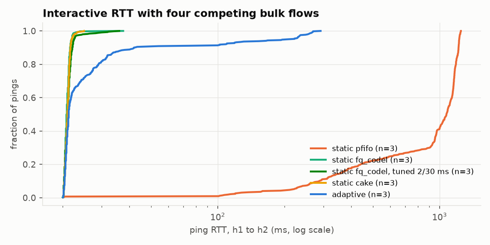
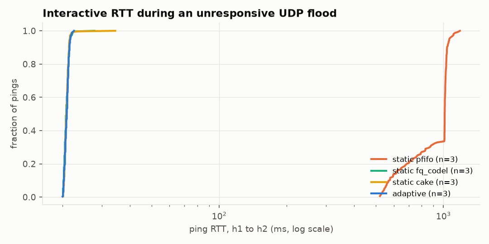
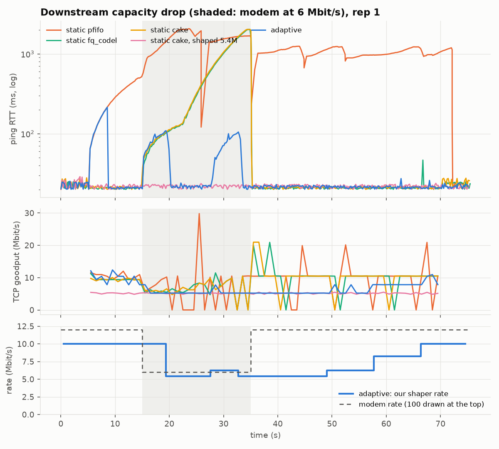
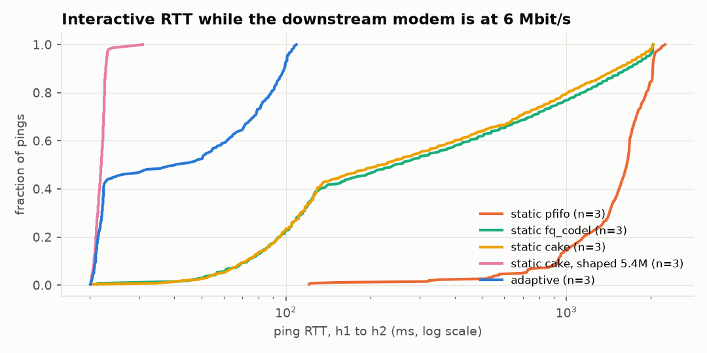

# Full evaluation results

Generated by `analyze.py` from the runs in this folder. Every cell is **mean ± standard deviation across repetitions**; `n` is the number of repetitions. RTT is the h1 ping probe (5 pings/s), an interactive user sharing the bottleneck with the load. Testbed: 10 Mbit/s managed bottleneck, 20 ms base RTT (80 ms for h3), downstream modem 100 Mbit/s unless the scenario changes it.

## bulk

One bulk TCP upload from h1 next to an interactive user (the canonical case).

Window: [6, 36] s (the bulk flow's lifetime, including the seconds before any controller reacts).

| system | n | RTT p50 ms | RTT p95 ms | RTT p99 ms | TCP goodput Mbit/s | drops at our qdisc | time to good | qdisc changes | detection s |
|---|---|---|---|---|---|---|---|---|---|
| static pfifo | 3 | 948.2 ± 25.1 | 1251.0 ± 35.7 | 1260.7 ± 37.2 | 10.12 ± 0.14 | 338 ± 2 | – (never in 3/3) | 0.0 ± 0.0 | – |
| static fq_codel | 3 | 20.9 ± 0.0 | 21.7 ± 0.1 | 23.8 ± 2.6 | 9.51 ± 0.03 | 69 ± 0 | 0.1 ± 0.0 s | 0.0 ± 0.0 | – |
| static fq_codel, tuned 2/30 ms | 3 | 20.9 ± 0.1 | 21.7 ± 0.0 | 23.9 ± 2.9 | 8.84 ± 0.00 | 98 ± 3 | 0.1 ± 0.0 s | 0.0 ± 0.0 | – |
| static cake | 3 | 20.9 ± 0.1 | 21.7 ± 0.0 | 22.9 ± 0.7 | 9.47 ± 0.02 | 68 ± 1 | 0.1 ± 0.0 s | 0.0 ± 0.0 | – |
| adaptive | 3 | 21.1 ± 0.1 | 148.7 ± 5.5 | 203.3 ± 0.2 | 9.66 ± 0.03 | 87 ± 6 | 3.8 ± 0.0 s | 1.0 ± 0.0 | 3.2 ± 0.0 |
| adaptive + CoDel tuning | 3 | 21.0 ± 0.1 | 131.5 ± 16.3 | 187.7 ± 12.7 | 8.99 ± 0.11 | 176 ± 9 | 3.5 ± 0.3 s | 1.0 ± 0.0 | 2.8 ± 0.3 |
| adaptive, enter 25 ms | 3 | 21.1 ± 0.1 | 122.5 ± 1.7 | 185.8 ± 7.3 | 9.41 ± 0.30 | 79 ± 2 | 3.5 ± 0.3 s | 1.0 ± 0.0 | 2.7 ± 0.0 |
| adaptive, enter 100 ms | 3 | 21.0 ± 0.1 | 199.2 ± 7.3 | 257.3 ± 5.9 | 9.65 ± 0.04 | 99 ± 3 | 4.9 ± 0.1 s | 1.0 ± 0.0 | 4.2 ± 0.1 |

## multi

Four bulk TCP flows, two from h1 (20 ms) and two from h3 (80 ms): fairness and RTT-fairness.

| system | n | RTT p50 ms | RTT p95 ms | RTT p99 ms | TCP goodput Mbit/s | drops at our qdisc | time to good | qdisc changes | h3 probe RTT p99 | Jain index (4 flows) | h1 share of goodput |
|---|---|---|---|---|---|---|---|---|---|---|---|
| static pfifo | 3 | 1073.2 ± 8.3 | 1227.6 ± 3.1 | 1240.3 ± 7.3 | 10.78 ± 0.10 | 570 ± 4 | – (never in 3/3) | 0.0 ± 0.0 | 1303.2 ± 4.0 | 0.958 ± 0.008 | 0.60 ± 0.01 |
| static fq_codel | 3 | 20.9 ± 0.1 | 22.0 ± 0.2 | 22.7 ± 0.5 | 9.70 ± 0.04 | 351 ± 7 | 0.1 ± 0.0 s | 0.0 ± 0.0 | 84.8 ± 3.7 | 0.994 ± 0.000 | 0.54 ± 0.00 |
| static fq_codel, tuned 2/30 ms | 3 | 21.1 ± 0.1 | 22.7 ± 0.7 | 28.1 ± 4.5 | 9.09 ± 0.35 | 421 ± 23 | 0.1 ± 0.0 s | 0.0 ± 0.0 | 91.1 ± 3.5 | 0.953 ± 0.030 | 0.61 ± 0.04 |
| static cake | 3 | 21.0 ± 0.1 | 22.0 ± 0.4 | 23.0 ± 1.2 | 9.54 ± 0.01 | 367 ± 3 | 0.1 ± 0.0 s | 0.0 ± 0.0 | 86.4 ± 2.0 | 0.996 ± 0.001 | 0.53 ± 0.00 |
| adaptive | 3 | 23.1 ± 3.8 | 200.3 ± 17.0 | 261.4 ± 6.5 | 9.80 ± 0.05 | 372 ± 5 | 4.6 ± 2.4 s | 1.0 ± 0.0 | 326.1 ± 10.3 | 0.985 ± 0.002 | 0.56 ± 0.00 |

Two flows each from h1 (20 ms RTT) and h3 (80 ms RTT); a fair split gives Jain 1.0 and h1 share 0.50.

## udpflood

A bulk TCP flow, then an unresponsive 12 Mbit/s UDP flood from h3 that ignores drops.

| system | n | RTT p99 before flood | RTT p50 in flood | RTT p99 in flood | TCP Mbit/s before | TCP Mbit/s in flood | UDP loss | qdisc changes |
|---|---|---|---|---|---|---|---|---|
| static pfifo | 3 | 512.0 ± 4.3 | 1015.0 ± 4.4 | 1117.3 ± 15.5 | 10.49 ± 0.02 | 2.44 ± 0.29 | 22 ± 1 % | 0.0 ± 0.0 |
| static fq_codel | 3 | 22.6 ± 0.9 | 20.8 ± 0.1 | 22.2 ± 0.2 | 9.56 ± 0.02 | 4.83 ± 0.03 | 40 ± 0 % | 0.0 ± 0.0 |
| static cake | 3 | 22.1 ± 0.4 | 20.8 ± 0.1 | 21.9 ± 0.2 | 9.40 ± 0.04 | 4.83 ± 0.04 | 41 ± 0 % | 0.0 ± 0.0 |
| adaptive | 3 | 218.7 ± 15.2 | 20.9 ± 0.1 | 22.0 ± 0.2 | 10.12 ± 0.08 | 4.79 ± 0.06 | 40 ± 0 % | 1.0 ± 0.0 |

## capacity

Bulk TCP while the downstream modem drops from 100 to 6 Mbit/s and recovers: the queue moves out of our qdisc.

Phases: modem at 100 Mbit/s (5–15 s), at 6 Mbit/s (15–35 s), back at 100 Mbit/s (35–70 s).

| system | n | p99 fast, before | p99 slow | p99 fast, after | Mbit/s fast, before | Mbit/s slow | Mbit/s fast, after | time to good (slow) | qdisc changes |
|---|---|---|---|---|---|---|---|---|---|
| static pfifo | 3 | 513.1 ± 0.2 | 2115.7 ± 94.7 | 1315.1 ± 29.7 | 10.59 ± 0.02 | 6.65 ± 0.04 | 9.44 ± 0.18 | – (never in 3/3) | 0.0 ± 0.0 |
| static fq_codel | 3 | 24.5 ± 4.7 | 2029.0 ± 3.4 | 1174.8 ± 134.4 | 9.50 ± 0.10 | 6.70 ± 0.26 | 9.87 ± 0.28 | – (never in 3/3) | 0.0 ± 0.0 |
| static cake | 3 | 27.6 ± 9.4 | 2013.2 ± 19.0 | 1225.8 ± 355.9 | 9.34 ± 0.11 | 6.52 ± 0.09 | 9.98 ± 0.17 | – (never in 3/3) | 0.0 ± 0.0 |
| static cake, shaped 5.4M | 3 | 24.1 ± 1.7 | 25.2 ± 3.4 | 23.4 ± 0.1 | 5.17 ± 0.01 | 5.15 ± 0.03 | 5.15 ± 0.00 | 0.1 ± 0.1 s | 0.0 ± 0.0 |
| adaptive | 3 | 210.6 ± 1.9 | 106.7 ± 0.6 | 23.8 ± 0.5 | 9.93 ± 0.03 | 5.47 ± 0.00 | 6.48 ± 0.07 | 5.1 ± 0.0 s | 7.0 ± 0.0 |
| adaptive, enter 25 ms | 3 | 190.1 ± 0.6 | 94.6 ± 2.8 | 22.8 ± 0.1 | 9.89 ± 0.06 | 5.46 ± 0.03 | 6.76 ± 0.07 | 4.3 ± 0.3 s | 7.0 ± 0.0 |
| adaptive, enter 100 ms | 3 | 269.3 ± 14.4 | 221.8 ± 40.5 | 27.0 ± 5.4 | 10.13 ± 0.06 | 5.64 ± 0.07 | 8.53 ± 0.20 | 11.2 ± 0.9 s | 5.0 ± 0.0 |

## onoff

Bulk TCP switching on and off every 4 s: stability stress near the thresholds.

| system | n | RTT p50 ms | RTT p95 ms | RTT p99 ms | TCP goodput Mbit/s | drops at our qdisc | time to good | qdisc changes |
|---|---|---|---|---|---|---|---|---|
| static pfifo | 3 | 91.1 ± 3.9 | 242.9 ± 4.1 | 260.3 ± 3.2 | 5.94 ± 0.05 | 0 ± 0 | 4.7 ± 0.1 s | 0.0 ± 0.0 |
| static fq_codel | 3 | 21.2 ± 0.1 | 26.4 ± 2.2 | 27.0 ± 2.4 | 5.44 ± 0.04 | 55 ± 1 | 0.1 ± 0.0 s | 0.0 ± 0.0 |
| static cake | 3 | 21.3 ± 0.1 | 25.6 ± 2.7 | 27.2 ± 2.5 | 5.23 ± 0.02 | 45 ± 0 | 0.1 ± 0.0 s | 0.0 ± 0.0 |
| adaptive | 3 | 21.5 ± 0.2 | 127.2 ± 0.0 | 200.6 ± 5.7 | 5.51 ± 0.01 | 53 ± 1 | 3.7 ± 0.0 s | 1.0 ± 0.0 |

Load switches on and off every 4 s; the controller's idle cooldown is 8 s, so a stable controller should change the qdisc once and then hold.

## confounders

Things that raise RTT but are not a standing queue: a 20 -> 120 ms path change on an idle link, then 1.5 s bursts; then a real sustained upload. Only the last should trigger.

| system | n | detections before the real load (false positives) | runs that detected the real load | detection latency | RTT p99 during real load |
|---|---|---|---|---|---|
| adaptive | 3 | 0.0 ± 0.0 | 3/3 | 4.1 ± 0.2 s | 376.0 ± 115.5 |

## overhead

Observer cost: an unshaped 10 Gbit/s path with no added delay, so iperf3 is CPU-bound; observer on vs off, steady state only (first 5 s of the flow excluded).

| system | n | TCP goodput Mbit/s | eBPF ns per event | eBPF events/s | eBPF CPU (% of one core) | controller CPU (% of one core) | VM busy (all cores) |
|---|---|---|---|---|---|---|---|
| observer attached | 3 | 2143 ± 21 | 182 ± 8 | 873817 ± 7919 | 15.94 ± 0.80 % | 0.2 ± 0.0 % | 24.9 ± 0.6 % |
| observer detached | 3 | 2528 ± 116 | – | – | – | 0.2 ± 0.0 % | 25.3 ± 0.8 % |

eBPF cost comes from the kernel's own per-program counters (kernel.bpf_stats_enabled), covering both tracepoint programs; events/s counts every packet on every interface, since the interface filter runs inside the program.

